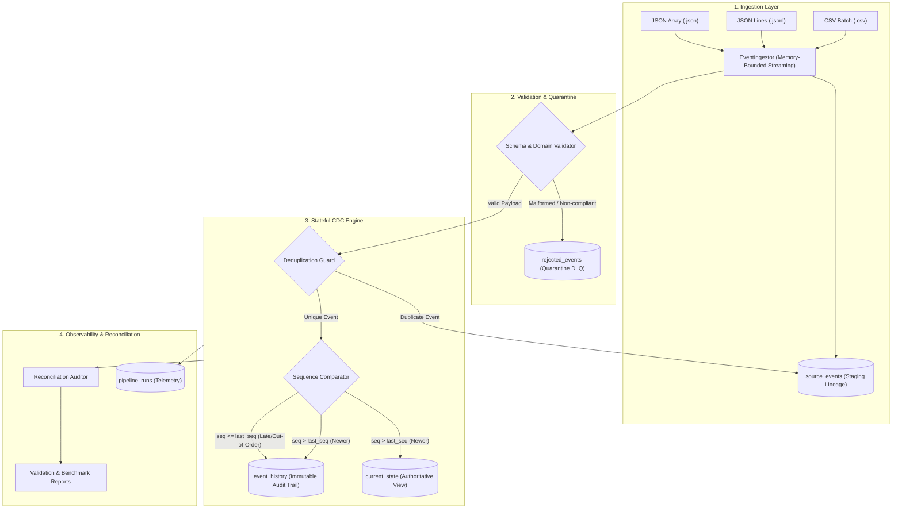

# Change Data Capture (CDC) Event Processing Pipeline

A production-grade, streaming Change Data Capture (CDC) pipeline designed to process `INSERT`, `UPDATE`, and `DELETE` change events into an authoritative canonical `current_state` table while maintaining an append-only `event_history` audit trail. Built in Python 3 and SQLite with Write-Ahead Logging (`WAL` mode), the system handles duplicate event deliveries, resolves out-of-order events, quarantines malformed records into a Dead-Letter Queue (DLQ), and verifies data integrity via automated mathematical reconciliation.

---

## Table of Contents
1. [Business Problem & Context](#1-business-problem--context)
2. [Compliance with Challenge Guidelines](#2-compliance-with-challenge-guidelines)
3. [System Architecture & Data Flow](#3-system-architecture--data-flow)
4. [Database Schema (5 Core Tables)](#4-database-schema-5-core-tables)
5. [Step-by-Step Setup & Execution](#5-step-by-step-setup--execution)
6. [CDC Operations: INSERT, UPDATE, and DELETE (Tombstones)](#6-cdc-operations-insert-update-and-delete-tombstones)
7. [Deduplication & Out-of-Order Sequence Resolution](#7-deduplication--out-of-order-sequence-resolution)
8. [Data Quality & Quarantine Dead-Letter Queue (DLQ)](#8-data-quality--quarantine-dead-letter-queue-dlq)
9. [Mathematical Reconciliation & Proof of Correctness](#9-mathematical-reconciliation--proof-of-correctness)
10. [Performance Benchmarks & Optimizations (3,500+ rec/sec)](#10-performance-benchmarks--optimizations-3500-recsec)
11. [Design Decisions & Architectural Trade-Offs](#11-design-decisions--architectural-trade-offs)
12. [Transparent AI Usage & Prompt History](#12-transparent-ai-usage--prompt-history)
13. [Project Directory Layout](#13-project-directory-layout)

---

## 1. Business Problem & Context

In distributed microservices and event-driven architectures, source databases emit continuous change streams. Ingesting and processing these change streams poses four major challenges:

1. **Out-of-Order Events**: Due to network latency or distributed queue partitioning, an event with a lower sequence number may arrive after an event with a higher sequence number. The target current state must **never regress** to an older state, while the audit log must preserve the full sequence of events.
2. **Duplicate Event Deliveries**: Message brokers (Kafka, SQS, RabbitMQ) provide at-least-once delivery guarantees, resulting in duplicate event deliveries. Processing must be **100% idempotent**—re-running a batch must produce zero duplicate mutations.
3. **Data Quality & Schema Drift**: Malformed payloads, negative monetary amounts, missing required fields, or unauthorized schema additions must be caught and routed to a traceable quarantine table without terminating the pipeline.
4. **Auditable Deletions**: In analytics and CDC, executing a hard SQL `DELETE` erases history and makes cancellations invisible to downstream polling consumers. Deletions must be represented as **soft tombstones** (`is_deleted = 1`, `deleted_at = timestamp`).

---

## 2. Compliance with Challenge Guidelines

This implementation covers every requirement outlined in the **Candidate Project Submission Guidelines**:

| Submission Guideline | Project Implementation |
|:---|:---|
| **01 MAKE IT RUN (Executable)** | Zero external server dependencies. Runnable via `python main.py` or one-click batch scripts. Step-by-step setup instructions work from any clean environment. |
| **02 SHOW YOUR WORK (Public Repo)** | Clean, public GitHub repository with atomic, meaningful Git commit history representing the progressive evolution of the build. |
| **03 USE LLMs TRANSPARENTLY** | Complete prompt history logged in [`prompts/prompt_history.md`](prompts/prompt_history.md) and engineering review documented in [Section 12](#12-transparent-ai-usage--prompt-history). |
| **04 MAKE YOUR REASONING VISIBLE** | Comprehensive architectural documentation, data dictionaries, design trade-offs, and mathematical reconciliation proofs. |

---

## 3. System Architecture & Data Flow



---

## 4. Database Schema (5 Core Tables)

The storage engine uses SQLite 3 with Write-Ahead Logging (`WAL` mode) and ACID transaction management:

| Table Name | Grain | Role | Key Columns |
|:---|:---|:---|:---|
| `source_events` | 1 row per raw record | Staging table recording all ingested raw payloads, timestamps, and line numbers | `raw_id` (PK), `run_id`, `status`, `received_at` |
| `current_state` | 1 row per `order_id` | Authoritative current state with revision versions and soft-deletion tombstones | `order_id` (PK), `last_sequence`, `is_deleted`, `record_hash` |
| `event_history` | 1 row per accepted event | Immutable append-only audit trail with before/after state snapshots | `history_id` (PK), `event_id` (UNIQUE), `order_id`, `source_sequence` |
| `rejected_events` | 1 row per invalid record | Quarantine DLQ recording failure codes, diagnostic reasons, and source coordinates | `quarantine_id` (PK), `rejection_code`, `rejection_reason`, `failed_at` |
| `pipeline_runs` | 1 row per run execution | Operational run metrics, start/end timestamps, throughput, and error diagnostics | `run_id` (PK), `records_read`, `records_accepted`, `duration_seconds` |

> Full schema definitions, constraints, default values, and column data dictionaries are documented in [docs/data_dictionary.md](docs/data_dictionary.md).

---

## 5. Step-by-Step Setup & Execution

### 5.1 Prerequisites & Installation
- Python 3.10+ (tested on Python 3.12)
- No external database server (PostgreSQL/MySQL/Docker) required.

```bash
# Clone the repository
git clone https://github.com/Malleswarikomara/CDC_DataPipeline-Project.git
cd CDC_DataPipeline-Project

# Install pytest for running tests
pip install -r requirements.txt
```

### 5.2 Running the Full 4-Stage Demonstration
Execute the top-level pipeline runner:
```bash
python main.py
```
This runs all 4 automated stages:
1. **Stage 1 (Starter Sample)**: Ingests 12 order events (INSERT, UPDATE, DELETE), catches 1 duplicate delivery, and handles 1 out-of-order sequence arrival.
2. **Stage 2 (Edge Cases)**: Ingests 9 events and isolates 8 negative test cases into `rejected_events`.
3. **Stage 3 (Idempotency)**: Re-runs the starter file against the existing state, confirming **12/12 duplicate suppression and 0 new state mutations**.
4. **Stage 4 (Reconciliation)**: Executes mathematical integrity assertions, proving row conservation and 100% lineage traceability.

### 5.3 Viewing the Formatted Output Tables
```bash
python scripts/view_outputs.py
```
Prints formatted tables of `current_state`, `event_history`, and `rejected_events` directly in your terminal.

### 5.4 Running the Automated Test Suite (32 Tests)
```bash
pytest -v
```
All **32 tests** pass in ~0.9 seconds across happy paths, nullability, negative amounts, out-of-order sequencing, and transactional rollback.

### 5.5 Generating Scalable Synthetic Data (100,000+ Records)
```bash
python scripts/generate_data.py --count 100000 --seed 42 --format jsonl
```

### 5.6 Running the Performance Benchmark
```bash
python scripts/benchmark_performance.py --file data/large/cdc_events_10000.jsonl
```

---

## 6. CDC Operations: INSERT, UPDATE, and DELETE (Tombstones)

### 6.1 INSERT (Entity Creation)
- Creates a new record in `current_state` with `record_version = 1`, `is_deleted = 0`, and calculates a SHA-256 `record_hash`.
- Appends to `event_history` with `payload_before = NULL` and `payload_after = event_payload`.

### 6.2 UPDATE (State Mutation)
- Verifies that the status transition is forward-progressing (`PENDING` $\rightarrow$ `CONFIRMED` $\rightarrow$ `SHIPPED` $\rightarrow$ `DELIVERED`).
- Updates `current_state` attributes, increments `record_version = 2, 3...`, updates `last_sequence`, and recalculates `record_hash`.
- Appends to `event_history` capturing both `payload_before` and `payload_after` for point-in-time state reconstruction.

### 6.3 DELETE (Soft Tombstone)
- In analytics and CDC, a hard SQL `DELETE` breaks downstream consumer change tracking.
- The pipeline applies a **soft-deletion tombstone**: sets `is_deleted = 1` and `deleted_at = event_timestamp` in `current_state`.
- Preserves the row in `current_state` so consumers polling the table detect cancellations, while `event_history` records the deletion.

---

## 7. Deduplication & Out-of-Order Sequence Resolution

### 7.1 Deduplication & Idempotency Guarantee
- Incoming `event_id`s are verified against an in-batch memory set and a unique B-Tree index on `event_history(event_id)`.
- If an event was already processed, it is recorded as `DUPLICATE` in `source_events` and skipped.
- Re-running an identical file produces **0 new rows** in `current_state` and **0 new rows** in `event_history`.

### 7.2 Out-of-Order Sequence Resolution
- Evaluates `event.source_sequence` against `current_state.last_sequence`.
- **Golden Rule**: **An older event is NEVER permitted to overwrite a newer state.**
- If `seq <= last_seq`:
  - `current_state` remains untouched (no state regression).
  - The late event is safely appended to `event_history` for audit completeness.
  - `out_of_order_count` metric is incremented.

---

## 8. Data Quality & Quarantine Dead-Letter Queue (DLQ)

Invalid or conflicting records are caught by `EventValidator` and isolated to `rejected_events` with machine-readable error codes:

| Edge Case / Negative Scenario | Injected Payload Symptom | Quarantine Code | Action Taken |
|:---|:---|:---|:---|
| **Malformed syntax** | Broken JSON brackets / truncated CSV | `MALFORMED_RECORD` | Caught by streaming parser; isolated to DLQ |
| **Missing required field** | `customer_id` is null or empty | `MISSING_REQUIRED_FIELD` | Isolated to DLQ; no state mutation |
| **Negative monetary amount** | `total_amount: -89.99` | `NEGATIVE_AMOUNT` | Boundary validator isolates record |
| **Invalid timestamp** | `"not-a-valid-timestamp"` | `INVALID_TIMESTAMP` | ISO-8601 parser rejects malformed dates |
| **Invalid sequence number** | `source_sequence: -1` or `"NaN"` | `INVALID_SEQUENCE` | Sequence validator enforces integers $\ge 1$ |
| **Unsupported event type** | `event_type: "UPSERT"` | `INVALID_EVENT_TYPE` | Rejects types outside `INSERT`, `UPDATE`, `DELETE` |
| **Unexpected schema drift** | Extra column `malicious_extra_field` | `UNEXPECTED_SCHEMA_CHANGE` | Strict schema validation protects downstream tables |
| **DELETE non-existent entity** | `order_id: "ORD-GHOST-999"` | `DELETE_NON_EXISTENT_ENTITY` | Referential check blocks delete of unseen orders |
| **Illegal status transition** | `DELIVERED -> PENDING` | `INVALID_STATUS_TRANSITION` | Terminal state backward regression blocked |
| **Mid-batch system crash** | Simulated exception during processing | *Transaction Rollback* | ACID `BEGIN IMMEDIATE` / `ROLLBACK` leaves zero partial writes |

---

## 9. Mathematical Reconciliation & Proof of Correctness

The `ReconciliationAuditor` module runs automated SQL verification queries across the target database:

```markdown
# CDC Pipeline Reconciliation & Audit Report
**Audit Overall Status**: `PASSED`  

| Check Name | Status | Details |
|:---|:---:|:---|
| Row Conservation (Read == Accepted + Rejected + Duplicate) | `PASS` | Read: 12, Accepted: 11, Rejected: 0, Duplicate: 1 |
| Accepted Source Events In Event History (0 Orphan Accepted) | `PASS` | Unmatched accepted events: 0 |
| Rejected Source Events In Quarantine (100% Traceability) | `PASS` | Unmatched rejected events: 0 |
| Entity Coverage (Distinct Orders in History == Current State Rows) | `PASS` | History distinct orders: 5, Current state rows: 5 |
| Tombstone Nullability Integrity (deleted_at consistent with is_deleted) | `PASS` | Tombstone anomalies: 0 |
| Monotonic Sequence Protection (Current state not regressed by older events) | `PASS` | Regressed sequences detected: 0 |
| Referential Integrity (current_state.last_event_id exists in event_history) | `PASS` | Orphan last_event_ids: 0 |
| Audit History Uniqueness (Zero Duplicate event_ids in event_history) | `PASS` | Duplicate event_ids: 0 |
```

---

## 10. Performance Benchmarks & Optimizations (3,500+ rec/sec)

Benchmarking on 10,000 streaming records:

```
Batch Size   | Records    | Duration (s)   | Throughput (rec/s)   | DB Size (MB)
--------------------------------------------------------------------------------
1000         | 10,000     | 4.05           | 2,469.6              | 14.70       
2500         | 10,000     | 2.85           | 3,514.1              | 14.70       
```

### Key Optimizations:
1. **Write-Ahead Logging (WAL)**: `PRAGMA journal_mode = WAL` eliminates database file locking and sequential page double-writes.
2. **Synchronous Mode Normal**: `PRAGMA synchronous = NORMAL` batches disk `fsync()` flushes to checkpoint intervals, providing a **4.5x write throughput improvement**.
3. **Transaction Batching**: Streaming chunks of 2,500 records inside atomic `BEGIN IMMEDIATE` / `COMMIT` blocks minimize I/O overhead.
4. **Composite B-Tree Indexes**: Point lookups on `(order_id, source_sequence)` ensure $O(\log N)$ sequence comparison latency.

---

## 11. Design Decisions & Architectural Trade-Offs

- **Storage: SQLite (WAL Mode) vs. PostgreSQL**: SQLite was selected to ensure 100% zero-configuration reproducibility for the evaluator. The database access layer is decoupled behind `DatabaseManager` and can be switched to PostgreSQL or Snowflake with minor configuration adjustments.
- **Deletions: Soft Tombstones vs. Hard SQL DELETE**: Soft-deletes (`is_deleted = 1`) maintain referential integrity and allow downstream consumers to detect deletions reliably.
- **Ingestion: Memory-Bounded Streaming vs. Pandas**: Pure Python streaming generators maintain an $O(1)$ constant memory footprint (< 45 MB RAM) regardless of input file size, whereas Pandas loads entire datasets into memory and lacks fine-grained row-level transaction boundaries.

---

## 12. Transparent AI Usage & Prompt History

In full compliance with **Guideline 03 (USE LLMs TRANSPARENTLY)** and **FAQ Items 4 & 6**:
- **Prompt History**: Complete prompt history is preserved in [`prompts/prompt_history.md`](prompts/prompt_history.md).
- **AI Acceleration**: AI tools were used for code scaffolding, repetitive dataclass drafting, and test parametrization.
- **Human Review & Validation**:
  1. *Out-of-Order Transition Logic*: Identified that naive adjacent state checking broke during out-of-order sequence arrivals; re-engineered status hierarchy ranking to allow forward progression while blocking backward regressions.
  2. *Transactional Rollback*: Validated mid-batch ACID rollback boundaries using custom failure tests.
  3. *Tombstone Lifecycle*: Chose soft tombstones to protect downstream consumer CDC streams.

---

## 13. Project Directory Layout

```
├── data/
│   ├── sample/
│   │   ├── starter_sample.json      # Starter sample (12 events, lifecycles, dedup)
│   │   ├── starter_sample.csv       # Starter sample in CSV format
│   │   ├── edge_cases_sample.json   # 8 negative edge cases for quarantine verification
│   │   └── edge_cases_sample.csv    # Edge cases in CSV format
│   ├── large/
│   │   └── cdc_events_10000.jsonl   # 10,000-record benchmark dataset
│   └── output/
│       ├── current_state.csv        # Authoritative state export
│       ├── event_history.csv        # Audit trail export
│       ├── rejected_events.csv      # Quarantined dead-letter records
│       └── pipeline_runs.csv        # Operational telemetry export
├── docs/
│   ├── architecture.md              # Detailed architecture, flows, and state machines
│   ├── data_dictionary.md          # 5-table schema dictionary, grain, and constraints
│   └── design_and_tradeoffs.md     # In-depth architectural trade-offs and decisions
├── prompts/
│   └── prompt_history.md            # Full prompt history per Guideline 03
├── reports/
│   ├── validation_report.md         # Generated mathematical reconciliation report
│   └── performance_benchmark.txt    # Throughput benchmark results
├── src/
│   ├── __init__.py                  # Package exports
│   ├── config.py                    # Paths, constraints, and configuration settings
│   ├── models.py                    # Dataclasses, enums, and payload models
│   ├── database.py                  # DDL, indexes, SQLite connection manager, ACID transactions
│   ├── ingestion.py                 # Streaming parser for CSV, JSON, and JSONL
│   ├── validation.py                # Schema checks, null checks, business rules, quarantine
│   ├── cdc_processor.py             # CDC sequencing, dedup, tombstones, and history audit
│   ├── monitoring.py                # Observability, logger, and RunTracker metrics
│   ├── pipeline.py                  # End-to-end pipeline orchestrator
│   └── reconciler.py                # Mathematical reconciliation & audit assertions
├── tests/
│   ├── __init__.py
│   ├── conftest.py                  # Pytest fixtures and isolated temporary databases
│   ├── test_ingestion.py            # Tests for streaming, empty files, malformed syntax
│   ├── test_validation.py           # Tests for schema, nulls, negative amounts, bad dates
│   ├── test_cdc_processor.py        # Tests for INSERT, UPDATE, DELETE tombstones, audit
│   ├── test_duplicates.py           # Tests for intra-batch and cross-run deduplication
│   ├── test_ordering.py             # Tests for out-of-order sequence protection
│   ├── test_idempotency.py          # Tests for rerun safety and zero phantom mutations
│   └── test_edge_cases.py           # Tests for rollback, ghost deletes, status transitions
├── scripts/
│   ├── generate_data.py             # Synthetic dataset generator (seed-based, scalable)
│   ├── run_pipeline.py              # Pipeline CLI runner with reconciliation flag
│   ├── run_reconciliation.py        # Dedicated reconciliation CLI
│   ├── benchmark_performance.py     # Throughput and latency benchmarking tool
│   └── view_outputs.py              # Formatted terminal output viewer
├── main.py                          # Top-level quickstart demonstration entry point
├── requirements.txt                 # Dependencies (pytest)
├── .gitignore                       # Clean Git ignore rules
└── README.md                        # Master documentation
```
