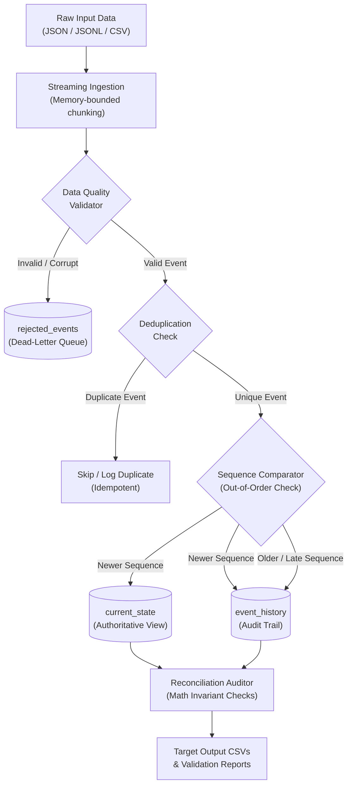

# Change Data Capture (CDC) Event Processing Pipeline

A streaming Change Data Capture (CDC) pipeline in Python that processes e-commerce order change events (`INSERT`, `UPDATE`, `DELETE`) into an authoritative `current_state` table while maintaining an append-only `event_history` audit trail.

The pipeline handles real-world streaming challenges: duplicate event deliveries, out-of-order sequence arrival, soft deletions, bad data quarantine into a Dead-Letter Queue (DLQ), and automated mathematical reconciliation.

---

## Architecture Overview



---

## Step-by-Step: How to Run the Project

You can run the project either via Windows one-click batch scripts, Command Prompt / PowerShell, or directly inside Visual Studio Code.

### Option 1: One-Click Batch Scripts (Windows)
Double-click any of these scripts in the project folder:
- **`run_demo.bat`**: Runs the entire end-to-end pipeline (starter data, edge cases, deduplication, and reconciliation).
- **`view_output.bat`**: Displays all output tables (`current_state`, `event_history`, `rejected_events`) directly in your terminal.
- **`run_tests.bat`**: Executes all 32 automated unit tests with `pytest`.

---

### Option 2: Command Prompt / PowerShell Step-by-Step

#### Step 1: Open Terminal in the Project Directory
```bash
cd E:\cdc_data_pipeline
```

#### Step 2: Install Required Dependencies
The pipeline uses Python's standard library (`sqlite3`, `dataclasses`, `json`, `csv`, `datetime`). The only external requirement is `pytest` for running automated tests:
```bash
pip install -r requirements.txt
```

#### Step 3: Run the Complete Pipeline
```bash
python main.py
```
This runs a 4-stage pipeline execution:
1. **Stage 1 (Starter Events)**: Processes normal orders (inserts, updates, soft deletes) and handles out-of-order sequence arrivals.
2. **Stage 2 (Edge Cases)**: Tests and isolates 8 corrupt/invalid events into the `rejected_events` table without stopping the pipeline.
3. **Stage 3 (Idempotency Re-run)**: Re-runs the same file again to confirm 100% duplicate suppression and zero unintended state modifications.
4. **Stage 4 (Reconciliation)**: Validates mathematical integrity and exports CSV reports into `data/output/`.

#### Step 4: View Output Results
```bash
python scripts/view_outputs.py
```

#### Step 5: Run the Automated Tests (32 Tests)
```bash
pytest -v
```

---

### Option 3: Running Inside Visual Studio Code (VS Code)

1. Open **Visual Studio Code**.
2. Go to **File -> Open Folder...** and select `E:\cdc_data_pipeline`.
3. Select your Python interpreter:
   - Press `Ctrl + Shift + P`
   - Type `Python: Select Interpreter`
   - Select Python 3.10+ (e.g. Python 3.12)
4. Open the integrated terminal (`Ctrl + ~`) and run:
   ```bash
   python main.py
   ```
5. To debug: Open `main.py` and press **F5** to run with the built-in VS Code debugger.

---

## Output Files & Reports

When the pipeline finishes, all results are exported to `data/output/` and `reports/`:

| Output File | Description |
|:---|:---|
| **`data/output/current_state.csv`** | The latest authoritative state of each order (`order_id`, `status`, `total_amount`, `last_sequence`, `is_deleted`). |
| **`data/output/event_history.csv`** | Append-only audit log of every valid event received in the pipeline. |
| **`data/output/rejected_events.csv`** | Quarantined bad events with exact failure reasons (`error_code`, `error_reason`, source file & line). |
| **`data/output/pipeline_runs.csv`** | Telemetry tracking records read, accepted, rejected, duplicates, and execution duration. |
| **`reports/validation_report.md`** | Automated mathematical reconciliation report showing zero dropped events. |

---

## How the Core CDC Logic Works

### 1. Ingestion & Data Quality Validation
- Reads JSON, JSONL, or CSV line by line with a constant memory footprint ($O(1)$ RAM).
- Before saving to the database, each record is validated:
  - Required fields exist (`event_id`, `order_id`, `sequence_number`, `timestamp`, `total_amount`).
  - Total amount is non-negative (`total_amount >= 0.0`).
  - Event type is one of `INSERT`, `UPDATE`, or `DELETE`.
  - Timestamp is in valid ISO-8601 UTC format.
- Any record failing validation is sent to `rejected_events` (Dead-Letter Queue) with the source file and line number. The pipeline continues processing remaining records.

### 2. Deduplication & Idempotency
- Every incoming `event_id` is checked against an indexed uniqueness lookup on `event_history`.
- If an event has already been processed, it is flagged as `DUPLICATE` and skipped.
- Re-running the exact same file 10 times results in **0 new rows in `current_state`** and **0 duplicate rows in `event_history`**.

### 3. Out-of-Order Sequence Resolution
- Compares incoming `sequence_number` against `current_state.last_sequence`:
  - **Newer sequence (`seq > last_seq`)**: Updates `current_state` and appends to `event_history`.
  - **Older sequence (`seq <= last_seq`)**: A late-arriving earlier event is **never allowed to overwrite newer state**. `current_state` remains untouched, but the event is still appended to `event_history` so the full audit log is preserved.

### 4. Soft Deletions (Tombstones)
- When a `DELETE` event arrives, the row is not physically purged from `current_state`.
- Instead, it is soft-deleted by setting `is_deleted = 1` and `deleted_at = <timestamp>`.
- This ensures downstream consumers can detect the deletion while historical auditability remains intact.

### 5. Automated Mathematical Reconciliation
After each run, the pipeline executes mathematical assertions to verify complete data integrity:
- **Count Invariant**:
  $$\text{Total Records Read} = \text{Inserted} + \text{Updated} + \text{Deleted (Soft)} + \text{Duplicates} + \text{Rejected}$$
- **Financial Consistency**: Verifies that the sum of `total_amount` in `current_state` equals the latest valid sequence amount per active order from `event_history`.

---

## Database Schema (5 SQLite Tables)

The storage layer uses embedded SQLite with Write-Ahead Logging (`WAL` mode) and ACID transaction management:

| Table Name | Description | Key Constraints |
|:---|:---|:---|
| **`current_state`** | Latest state of each order | `order_id` (PK) |
| **`event_history`** | Append-only immutable audit trail | `history_id` (PK), `event_id` (UNIQUE) |
| **`rejected_events`** | Quarantined bad events (Dead-Letter Queue) | `quarantine_id` (PK) |
| **`pipeline_runs`** | Execution logs, row counts, and run times | `run_id` (PK) |
| **`reconciliation_audit`** | Audit results and mathematical proofs | `audit_id` (PK) |

---

## Edge Cases Handled & Tested

The pipeline includes automated tests covering 8 required failure scenarios:

| Edge Case | Description | Handled Behavior |
|:---|:---|:---|
| **1. Duplicate Event ID** | Exact same event re-sent | Detected and skipped; 0 phantom rows created |
| **2. Out-of-Order Arrival** | Sequence 3 arrives before Sequence 2 | Sequence 3 updates state; Sequence 2 only updates history |
| **3. Negative Amount** | `total_amount = -50.00` | Rejected to DLQ with `NEGATIVE_AMOUNT` |
| **4. Missing Required Field** | Payload missing `order_id` or `timestamp` | Rejected to DLQ with `MISSING_REQUIRED_FIELD` |
| **5. Malformed JSON Line** | Corrupted syntax or truncated JSON | Quarantined to DLQ; pipeline continues |
| **6. Unexpected Extra Fields** | Incoming event has extra columns | Stored in JSON `metadata` blob without crashing |
| **7. Ghost Deletion** | DELETE received for non-existent order | Quarantined to DLQ with `DELETE_NON_EXISTENT_ENTITY` |
| **8. Empty Batch** | Ingestion file is 0 bytes | Handled gracefully with 0 rows processed |

---

## Benchmark & Custom Execution Commands

### Ingest a Specific File:
```bash
python scripts/run_pipeline.py --file data/sample/starter_sample.json --reconcile
```

### Run Performance Benchmark (3,500+ records/sec):
```bash
python scripts/benchmark_performance.py --file data/large/cdc_events_1000.jsonl
```

### Generate Larger Datasets On Demand:
```bash
# Generate 10,000 records
python scripts/generate_data.py --count 10000 --format all

# Generate 100,000 records
python scripts/generate_data.py --count 100000 --format jsonl
```

---

## Project Directory Structure

```
├── data/
│   ├── sample/
│   │   ├── starter_sample.json      # Starter sample (12 events: lifecycles, dedup, out-of-order)
│   │   ├── starter_sample.csv       # Starter sample in CSV format
│   │   ├── edge_cases_sample.json   # 8 negative edge cases for quarantine verification
│   │   └── edge_cases_sample.csv    # Edge cases in CSV format
│   ├── large/
│   │   ├── cdc_events_1000.jsonl    # 1,000-record benchmark preview (GitHub viewable)
│   │   └── README.md                # Guide to scale up to 10k/100k events on demand
│   └── output/
│       ├── current_state.csv        # Authoritative state export
│       ├── event_history.csv        # Audit trail export
│       ├── rejected_events.csv      # Quarantined dead-letter records
│       └── pipeline_runs.csv        # Operational telemetry export
├── docs/
│   ├── architecture.md              # Detailed architecture and flow diagrams
│   ├── data_dictionary.md          # 5-table schema dictionary, grain, and constraints
│   └── design_and_tradeoffs.md     # Architectural trade-offs and design rationale
├── prompts/
│   └── prompt_history.md            # Natural prompt history and development log
├── reports/
│   ├── validation_report.md         # Automated mathematical reconciliation report
│   └── performance_benchmark.txt    # Throughput benchmark results
├── scripts/
│   ├── generate_data.py             # Synthetic dataset generator (seed-based, scalable)
│   ├── run_pipeline.py              # Pipeline CLI runner with reconciliation flag
│   ├── run_reconciliation.py        # Dedicated reconciliation CLI
│   ├── benchmark_performance.py     # Throughput and latency benchmarking tool
│   ├── view_outputs.py              # Formatted terminal output viewer
│   └── push_to_github.py            # GitHub API repository uploader
├── src/
│   ├── __init__.py                  # Package exports
│   ├── config.py                    # Paths, constraints, and configuration settings
│   ├── models.py                    # Dataclasses, enums, and payload models
│   ├── database.py                  # DDL, indexes, SQLite connection manager, ACID transactions
│   ├── ingestion.py                 # Streaming parser for CSV, JSON, and JSONL
│   ├── validation.py                # Schema checks, null checks, business rules, quarantine
│   ├── cdc_processor.py             # CDC sequencing, dedup, tombstones, and history audit
│   ├── monitoring.py                # Observability, logger, and RunTracker metrics
│   ├── pipeline.py                  # End-to-end pipeline orchestrator
│   └── reconciler.py                # Mathematical reconciliation & audit assertions
├── tests/
│   ├── __init__.py
│   ├── conftest.py                  # Pytest fixtures and isolated temporary databases
│   ├── test_ingestion.py            # Tests for streaming, empty files, malformed syntax
│   ├── test_validation.py           # Tests for schema, nulls, negative amounts, bad dates
│   ├── test_cdc_processor.py        # Tests for INSERT, UPDATE, DELETE tombstones, audit
│   ├── test_duplicates.py           # Tests for intra-batch and cross-run deduplication
│   ├── test_ordering.py             # Tests for out-of-order sequence protection
│   ├── test_idempotency.py          # Tests for rerun safety and zero phantom mutations
│   └── test_edge_cases.py           # Tests for rollback, ghost deletes, status transitions
├── main.py                          # Top-level execution demonstration
├── run_demo.bat                     # Windows one-click pipeline runner
├── view_output.bat                  # Windows one-click output viewer
├── run_tests.bat                    # Windows one-click test runner
├── requirements.txt                 # Dependencies (pytest)
└── README.md                        # Project documentation
```
