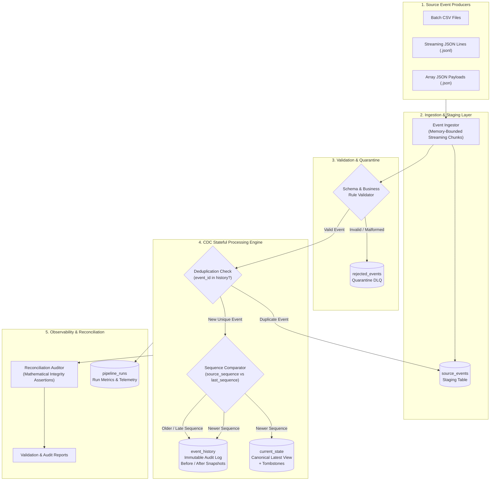

# System Architecture: Change Data Capture (CDC) Pipeline

## 1. Overview & Objective
This system provides an enterprise-grade Change Data Capture (CDC) pipeline designed to ingest, validate, sequence, and reconcile continuous streams of `INSERT`, `UPDATE`, and `DELETE` events from distributed source systems.

The core challenge addressed is maintaining a real-time canonical **Current State** table while preserving an immutable, auditable **Event History** log, resiliently handling:
1. **Out-of-order / late-arriving events** (preventing state regression while capturing audit evidence).
2. **Duplicate events** (idempotent at-least-once ingestion without phantom mutations).
3. **Data quality failures** (quarantining anomalous records into a traceable dead-letter queue).
4. **Failure recovery** (transactional ACID rollbacks preventing partial batch corruption).

---

## 2. High-Level Data Flow



---

## 3. Core Component Deep Dive

### 3.1 Event Ingestor (`src/ingestion.py`)
- **Streaming Generator**: Uses memory-bounded iterators to parse files chunk-by-chunk (default chunk size: 1,000–5,000 records). Can stream files of 100,000+ records without ballooning process memory.
- **Multi-Format Support**: Handles CSV, JSON Arrays, and JSON Lines (NDJSON).
- **Coordinate Tracking**: Tags every event with `source_file` and 1-based `source_row_num` to maintain 100% lineage traceability.

### 3.2 Schema & Semantic Validator (`src/validation.py`)
- **Type Coercion & Format Checks**: Validates ISO-8601 timestamps, positive integer sequences, and numeric non-negative currency amounts.
- **Strict Schema Drift Detection**: Rejects payloads containing unregistered extra fields to protect analytical downstream consumers from silent schema corruption.
- **Deterministic Quarantine Routing**: Emits structured `RejectedRecord` models containing exact error codes (`NEGATIVE_AMOUNT`, `INVALID_STATUS_TRANSITION`, `MISSING_REQUIRED_FIELD`) and writes them to `rejected_events`.

### 3.3 CDC Processing Engine (`src/cdc_processor.py`)
- **Deduplication Engine**: Employs a two-tier deduplication check:
  1. *In-batch set*: Catches intra-batch duplicate deliveries.
  2. *B-Tree Index Lookup*: Verifies whether `event_id` exists in `event_history`.
- **Out-of-Order Sequencer**:
  - Compares `event.source_sequence` against `current_state.last_sequence`.
  - **Golden Rule**: An older sequence (`seq <= last_seq`) is **NEVER** allowed to overwrite a newer state in `current_state`.
  - **Audit Preservation**: Out-of-order events are safely appended to `event_history` with full before/after snapshots, ensuring total visibility without state regression.
- **Tombstone Lifecycle**:
  - `DELETE` events do not hard-purge rows from `current_state`. Instead, they set `is_deleted = 1` and populate `deleted_at`, preserving foreign-key referential stability and giving consumers clean downstream CDC visibility.
  - Re-activations (`INSERT` on tombstone) reset `is_deleted = 0`.

### 3.4 Reconciliation & Audit Engine (`src/reconciler.py`)
- Formulates automated SQL assertions to verify mathematical consistency:
  $$\text{records\_read} = \text{records\_accepted} + \text{records\_rejected} + \text{records\_duplicate}$$
- Validates that:
  - All accepted records exist in `event_history`.
  - All rejected records exist in `rejected_events`.
  - Every active order in `current_state` has matching maximum sequence in `event_history`.
  - Zero duplicate `event_id`s exist in `event_history`.

---

## 4. State Transition & Lifecycle Diagram

```
       [Raw Event Received]
                 │
                 ▼
       {Is Schema & Payload Valid?}
        ├── NO  ──> [Quarantined in rejected_events]
        └── YES ──> {Is event_id Duplicate?}
                     ├── YES ──> [Flagged as DUPLICATE, Skipped]
                     └── NO  ──> {Does Entity Exist in current_state?}
                                  │
         ┌────────────────────────┴────────────────────────┐
         ▼                                                 ▼
      [No]                                               [Yes]
         │                                                 │
  {Event Type?}                                     {Sequence Check}
   ├── INSERT ──> Create new row in current_state    ├── seq <= last_seq ──> [Append to event_history only]
   │              Append to event_history            │                       (No mutation to current_state)
   ├── UPDATE ──> Create initial row from update     └── seq > last_seq  ──> {Event Type?}
   │              Append to event_history                                     ├── UPDATE ──> Apply update, inc version,
   └── DELETE ──> REJECT (Cannot delete ghost entity)                                        record history
                  Quarantine in rejected_events                               └── DELETE ──> Apply Tombstone (is_deleted=1),
                                                                                             record history
```
